# Passo 1: Auditoria Agêntica do C4 Nível 2 (Contêineres) — Smart Campus UniSenai

## Análise Arquitetural e Detecção de Gargalos

1. **Acoplamento Síncrono no Fluxo Crítico de Acesso (SPOF de Latência):** Se o `Serviço de Orquestração de Acesso e Energia` acionar fisicamente os `Dispositivos IoT` (iluminação, ar-condicionado e bancadas) e disparar notificações de forma síncrona durante a validação biométrica, qualquer lentidão na rede IoT ou em serviços externos bloqueará a liberação da porta do laboratório. A introdução do `Message Broker` (RabbitMQ) e do `Worker de Automação e Alertas` isola a resposta de acesso físico da orquestração energética.
2. **Ponto Único de Falha (SPOF) no Estado de Ocupação e Timers:** Manter a contagem de usuários presentes na `Sessão de Uso` e o temporizador da janela de tolerância de 15 minutos do ar-condicionado (`Perfil Energético`) na memória local de uma única instância impede escalabilidade horizontal e causa perda de estado em reinicializações. O `Cache de Estado e Timers` (Redis) externaliza esse estado operacional com alta disponibilidade.
3. **Concorrência entre Telemetria Contínua e Regras Transacionais:** O fluxo contínuo de leitura dos `Sensores` de consumo elétrico e presença disputando as mesmas conexões e threads que validam `Credencial Biométrica` e `Permissão` degrada a latência de acesso. Separar a ingestão no `API Gateway e IoT Broker` e processar regras de `Alerta de Desperdício` de forma assíncrona elimina a contenção.

## Diagrama C4 Nível 2 (Contêineres)

```mermaid
C4Container
    title Diagrama de Contêineres (C4 Nível 2) - Smart Campus UniSenai

    UpdateLayoutConfig($c4ShapeInRow="4", $c4BoundaryInRow="1")

    Person(gestor, "Gestor do Campus", "Monitora ocupação, metas de consumo e alertas de desperdício.")
    Person(usuario, "Usuário do Campus", "Aluno, Professor, Técnico ou Visitante que acessa os laboratórios.")
    System_Ext(leitor_biometrico, "Leitor Biométrico", "Terminal facial/digital instalado na porta de cada Ambiente.")
    System_Ext(rede_iot, "Dispositivos IoT", "Sensores de consumo/presença e Atuadores de AC, iluminação e bancadas.")

    Container_Boundary(smart_campus, "Smart Campus UniSenai") {
        Container(web_dashboard, "Portal Web de Gestão", "React, TypeScript", "Exibe ocupação em tempo real, relatórios de demanda e alertas.")
        Container(api_gateway, "API Gateway e IoT Broker", "Node.js, REST/MQTT", "Recebe eventos biométricos, telemetria de sensores e requisições web.")
        Container(orquestrador_service, "Serviço de Orquestração de Acesso e Energia", "Node.js, TypeScript", "Valida identidade/permissão, gerencia Sessão de Uso e regras de domínio.")
        Container(energia_worker, "Worker de Automação e Alertas", "Node.js, TypeScript", "Processa eventos assíncronos, tolerância de 15 min do AC, pré-condicionamento e desperdício.")

        ContainerDb(database, "Banco de Dados Principal", "PostgreSQL", "Persiste Usuários, Permissões, Logs de Acesso imutáveis, Sessões e Telemetria.")
        ContainerDb(cache_estado, "Cache de Estado e Timers", "Redis", "Armazena estado ativo de ocupação, contagem de presentes e TTL de 15 min do AC.")
        Container(message_broker, "Message Broker", "RabbitMQ", "Desacopla eventos de ocupação, comandos de atuadores e retentativas de notificação.")
    }

    System_Ext(sistema_academico, "Sistema de Grade Horária", "Sistema externo com agendamentos oficiais de aulas.")
    System_Ext(servico_notificacao, "Serviço Externo de E-mail", "Provedor SMTP/Notificações para alertas críticos.")

    Rel(usuario, leitor_biometrico, "Apresenta biometria")
    Rel(gestor, web_dashboard, "Consulta métricas", "HTTPS")
    Rel(leitor_biometrico, api_gateway, "Tentativa de acesso", "HTTPS/TLS")
    Rel(rede_iot, api_gateway, "Telemetria sensores", "MQTT")

    Rel(web_dashboard, api_gateway, "Consulta dados", "REST/JSON")
    Rel(api_gateway, orquestrador_service, "Valida acesso", "REST/gRPC")

    Rel(orquestrador_service, database, "Valida Permissão/Log", "SQL/TLS")
    Rel(orquestrador_service, cache_estado, "Estado ocupação", "TCP")
    Rel(orquestrador_service, message_broker, "Publica eventos", "AMQP")

    Rel(message_broker, energia_worker, "Consome eventos", "AMQP")
    Rel(energia_worker, cache_estado, "Timer 15 min AC", "TCP")
    Rel(energia_worker, database, "Salva Sessão/Energia", "SQL/TLS")

    Rel(energia_worker, rede_iot, "Aciona atuadores", "MQTT")
    Rel(energia_worker, sistema_academico, "Consulta grade", "REST/HTTPS")
    Rel(energia_worker, servico_notificacao, "Envia alertas", "SMTP/REST")

    UpdateRelStyle(usuario, leitor_biometrico, $textColor="#f1f5f9", $lineColor="#94a3b8", $offsetX="-60", $offsetY="-18")
    UpdateRelStyle(gestor, web_dashboard, $textColor="#f1f5f9", $lineColor="#94a3b8", $offsetX="-55", $offsetY="50")
    UpdateRelStyle(leitor_biometrico, api_gateway, $textColor="#f1f5f9", $lineColor="#94a3b8", $offsetX="-45", $offsetY="-12")
    UpdateRelStyle(rede_iot, api_gateway, $textColor="#f1f5f9", $lineColor="#94a3b8", $offsetX="15", $offsetY="-28")

    UpdateRelStyle(web_dashboard, api_gateway, $textColor="#f1f5f9", $lineColor="#94a3b8", $offsetX="-40", $offsetY="-24")
    UpdateRelStyle(api_gateway, orquestrador_service, $textColor="#f1f5f9", $lineColor="#94a3b8", $offsetX="-40", $offsetY="-24")

    UpdateRelStyle(orquestrador_service, database, $textColor="#f1f5f9", $lineColor="#94a3b8", $offsetX="-65", $offsetY="-10")
    UpdateRelStyle(orquestrador_service, cache_estado, $textColor="#f1f5f9", $lineColor="#94a3b8", $offsetX="-15", $offsetY="-40")
    UpdateRelStyle(orquestrador_service, message_broker, $textColor="#f1f5f9", $lineColor="#94a3b8", $offsetX="-30", $offsetY="-35")

    UpdateRelStyle(message_broker, energia_worker, $textColor="#f1f5f9", $lineColor="#94a3b8", $offsetX="-32", $offsetY="0")
    UpdateRelStyle(energia_worker, cache_estado, $textColor="#f1f5f9", $lineColor="#94a3b8", $offsetX="12", $offsetY="-5")
    UpdateRelStyle(energia_worker, database, $textColor="#f1f5f9", $lineColor="#94a3b8", $offsetX="0", $offsetY="10")

    UpdateRelStyle(energia_worker, rede_iot, $textColor="#f1f5f9", $lineColor="#94a3b8", $offsetX="55", $offsetY="0")
    UpdateRelStyle(energia_worker, sistema_academico, $textColor="#f1f5f9", $lineColor="#94a3b8", $offsetX="-140", $offsetY="-70")
    UpdateRelStyle(energia_worker, servico_notificacao, $textColor="#f1f5f9", $lineColor="#94a3b8", $offsetX="48", $offsetY="-15")
```

