# Diagrama de Classes e Componentes (Desacoplamento por Interfaces e Injeção de Dependência)

Este diagrama demonstra a aplicação do Princípio da Inversão de Dependência (DIP) e Injeção de Dependência nos serviços centrais do **Smart Campus UniSenai**, isolando as regras de negócio de acesso e energia dos detalhes de infraestrutura (PostgreSQL, Redis, RabbitMQ, MQTT e SMTP).

```mermaid
classDiagram
    direction TB

    class ServicoOrquestracaoAcessoEnergia {
        -IPermissaoRepository permissaoRepo
        -IAcessoRepository acessoRepo
        -IEstadoOcupacaoCache estadoCache
        -IEventoPublisher eventoPublisher
        +validarAcesso(credencial: CredencialBiometrica, ambienteId: UUID) ResultadoAcesso
        +registrarSaida(usuarioId: UUID, ambienteId: UUID) void
    }

    class WorkerAutomacaoAlertas {
        -IDispositivoAtuadorGateway atuadorGateway
        -IGradeHorariaProvider gradeHorariaProvider
        -INotificacaoService notificacaoService
        -IEstadoOcupacaoCache estadoCache
        +processarEventoOcupacao(evento: EventoOcupacao) void
        +avaliarDesperdicio(ambienteId: UUID, consumoWatts: float) void
        +executarPreCondicionamento(ambienteId: UUID) void
    }

    class IPermissaoRepository {
        <<interface>>
        +buscarPermissaoVigente(usuarioId: UUID, ambienteId: UUID, instante: DateTime) Permissao
    }

    class IAcessoRepository {
        <<interface>>
        +registrarAcesso(acesso: Acesso) void
    }

    class IEstadoOcupacaoCache {
        <<interface>>
        +incrementarPresentes(ambienteId: UUID) int
        +decrementarPresentes(ambienteId: UUID) int
        +agendarDesligamentoAC(ambienteId: UUID, minutosTolerancia: int) void
        +buscarPermissaoFallback(usuarioId: UUID, ambienteId: UUID) Permissao
    }

    class IEventoPublisher {
        <<interface>>
        +publicarEventoOcupacao(evento: EventoOcupacao) void
        +publicarAlertaDesperdicio(alerta: AlertaDesperdicio) void
        +enfileirarRetentativa(topico: string, payload: string) void
    }

    class IDispositivoAtuadorGateway {
        <<interface>>
        +acionarIluminacao(ambienteId: UUID, ligar: boolean) void
        +acionarClimatizacao(ambienteId: UUID, ligar: boolean) void
        +acionarBancadas(ambienteId: UUID, ligar: boolean) void
    }

    class IGradeHorariaProvider {
        <<interface>>
        +consultarProximaAula(ambienteId: UUID, janelaMinutos: int) AgendamentoAula
    }

    class INotificacaoService {
        <<interface>>
        +enviarAlerta(destinatario: string, assunto: string, corpo: string) void
    }

    class PostgresPermissaoRepository {
        +buscarPermissaoVigente(usuarioId: UUID, ambienteId: UUID, instante: DateTime) Permissao
    }

    class RedisEstadoOcupacaoCache {
        +incrementarPresentes(ambienteId: UUID) int
        +decrementarPresentes(ambienteId: UUID) int
        +agendarDesligamentoAC(ambienteId: UUID, minutosTolerancia: int) void
        +buscarPermissaoFallback(usuarioId: UUID, ambienteId: UUID) Permissao
    }

    class RabbitMqEventoPublisher {
        +publicarEventoOcupacao(evento: EventoOcupacao) void
        +publicarAlertaDesperdicio(alerta: AlertaDesperdicio) void
        +enfileirarRetentativa(topico: string, payload: string) void
    }

    class MqttAtuadorGateway {
        +acionarIluminacao(ambienteId: UUID, ligar: boolean) void
        +acionarClimatizacao(ambienteId: UUID, ligar: boolean) void
        +acionarBancadas(ambienteId: UUID, ligar: boolean) void
    }

    class SmtpNotificacaoService {
        +enviarAlerta(destinatario: string, assunto: string, corpo: string) void
    }

    ServicoOrquestracaoAcessoEnergia --> IPermissaoRepository : injeta via construtor
    ServicoOrquestracaoAcessoEnergia --> IAcessoRepository : injeta via construtor
    ServicoOrquestracaoAcessoEnergia --> IEstadoOcupacaoCache : injeta via construtor
    ServicoOrquestracaoAcessoEnergia --> IEventoPublisher : injeta via construtor

    WorkerAutomacaoAlertas --> IDispositivoAtuadorGateway : injeta via construtor
    WorkerAutomacaoAlertas --> IGradeHorariaProvider : injeta via construtor
    WorkerAutomacaoAlertas --> INotificacaoService : injeta via construtor
    WorkerAutomacaoAlertas --> IEstadoOcupacaoCache : injeta via construtor

    IPermissaoRepository <|.. PostgresPermissaoRepository : implementa
    IEstadoOcupacaoCache <|.. RedisEstadoOcupacaoCache : implementa
    IEventoPublisher <|.. RabbitMqEventoPublisher : implementa
    IDispositivoAtuadorGateway <|.. MqttAtuadorGateway : implementa
    INotificacaoService <|.. SmtpNotificacaoService : implementa
```

