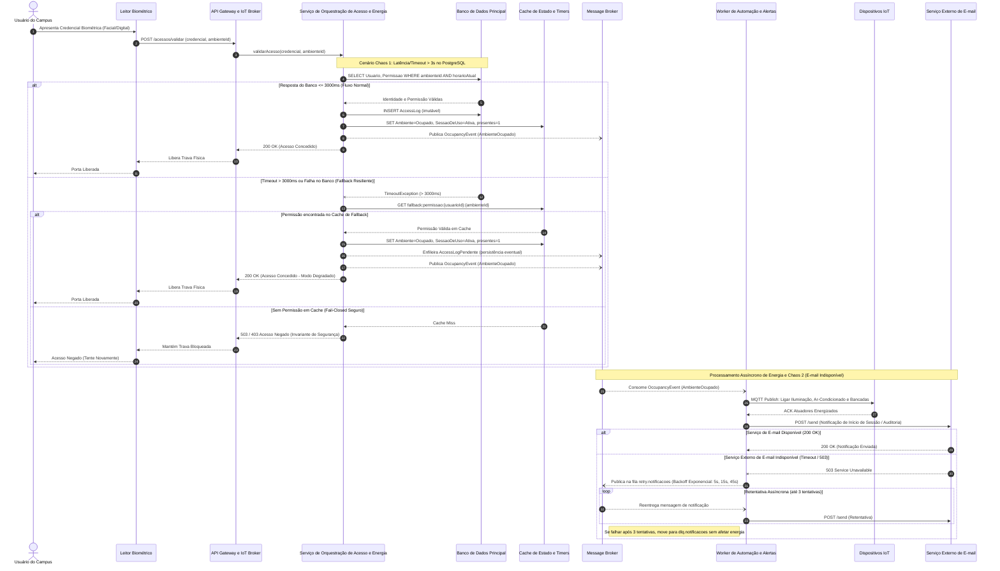

# Passo 2: Engenharia de Chaos e Resiliência no Diagrama de Sequência

## Cenários de Falha Injetados

1. **Timeout > 3 segundos no Banco de Dados Principal (PostgreSQL):**
   - O `Serviço de Orquestração de Acesso e Energia` aplica um *timeout* rígido de 3000ms na consulta de identidade e permissão.
   - Em caso de estouro, aciona fallback no `Cache de Estado e Timers` (Redis). Se a permissão pré-sincronizada existir em cache, libera o acesso e enfileira o registro de auditoria (`AccessLogPendente`) no `Message Broker` (RabbitMQ) para persistência eventual. Caso não exista em cache, aplica *fail-closed* seguro (nega acesso e não energiza equipamentos, respeitando os invariantes do domínio).
2. **Indisponibilidade do Serviço Externo de E-mail:**
   - Caso o `Serviço Externo de E-mail` retorne erro `503` ou *timeout*, o `Worker de Automação e Alertas` não bloqueia o acionamento dos `Dispositivos IoT` e encaminha a notificação para uma fila de retentativas (`retry.notificacoes`) no `Message Broker` com *backoff* exponencial (5s, 15s, 45s) e *Dead Letter Queue* (`dlq.notificacoes`).

## Diagrama de Sequência Resiliente

